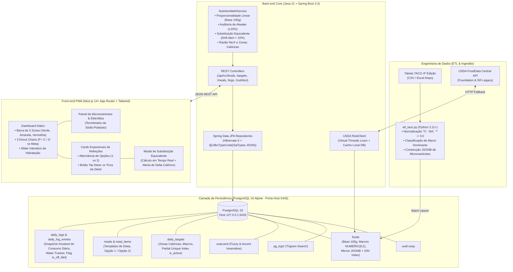

# 🗺️ 00 - Mapa de Conteúdo (MOC): Precision Nutrition Engine

Bem-vindo ao **Cérebro Externo** e **Fonte Única da Verdade (SSOT)** do **Precision Nutrition Engine**.
Este projeto implementa uma plataforma de rastreamento e planejamento nutricional com rigor matemático cirúrgico, inspirada na experiência de usuário do app USFit, combinando a precisão da Tabela Brasileira de Composição de Alimentos (**TACO 4ª edição**) e a amplitude do **USDA FoodData Central**.

---

## 🧭 Índice do Cofre (WikiLinks)
- [[00_MOC_Mapa_Mental]]: Este documento mestre (Arquitetura, MOC e ADRs).
- [[01_Data_Contracts_DDL_JSONB]]: Contratos relacionais, esquemas DDL PostgreSQL e contrato estrito de micronutrientes em JSONB.
- [[02_API_&_Math_Specs]]: Formulação matemática (Atwater, Substituição, Calorie Drift) e contratos REST da API.
- [[99_State_Tracker_Kanban]]: Estado do projeto, checklist de fases, inventário de arquivos e controle de débito técnico.

---

## 🏗️ Visão Geral da Arquitetura do Sistema

---

## 🏛️ Registros de Decisão Arquitetural (ADRs)

### ADR-001: Rigor Numérico e Proibição de Tipos Ponto Flutuante (IEEE 754)
- **Status:** Aprovado / Imutável
- **Contexto:** Tipos `FLOAT` ou `DOUBLE` sofrem de imprecisão binária de representação (ex: `0.1 + 0.2 = 0.30000000000000004`). Em nutrição clínica e esportiva de alta precisão, o acúmulo de frações infinitesimais em dezenas de itens diários causa desvios perceptíveis nas calorias totais e no balanço de macronutrientes.
- **Decisão:** 
  1. No PostgreSQL: Uso estrito de `NUMERIC(8,2)` para todos os macronutrientes, pesos em gramas, calorias e volumes de água.
  2. No Java: Uso mandatório de `java.math.BigDecimal` com `RoundingMode.HALF_UP` em todos os cálculos do `NutritionMathService`.
  3. No TypeScript: Conversão explícita com arredondamento padronizado em 2 casas decimais na camada de apresentação.

### ADR-002: Modelo Híbrido Relacional + JSONB para Micronutrientes
- **Status:** Aprovado
- **Contexto:** Alimentos contêm dezenas de micronutrientes (vitaminas, minerais, fitoquímicos), com coberturas muito heterogêneas entre as tabelas TACO e USDA. Criar 60+ colunas relacionais tornaria a tabela `foods` esparsa, rígida para evolução e sujeita a migrações custosas de DDL. Por outro lado, um modelo puramente NoSQL sacrificaria a integridade referencial dos macronutrientes.
- **Decisão:** 
  - Macronutrientes principais (`energy_kcal`, `protein_g`, `carbohydrate_g`, `lipid_g`, `fiber_g`) são colunas relacionais `NUMERIC(8,2)` indexadas e validadas por `CHECK constraints`.
  - Micronutrientes padronizados (9 elementos prioritários: Cálcio, Ferro, Magnésio, Potássio, Sódio, Zinco, Vitamina C, Vitamina B12, Colesterol) residem em coluna `JSONB` com índice `GIN (jsonb_path_ops)`, garantindo consultas em milissegundos e extensibilidade futura sem migração de schema.

### ADR-003: Imutabilidade Histórica de Registros (`meals` vs `daily_logs`)
- **Status:** Aprovado
- **Contexto:** Se um usuário alterar sua dieta padrão (template em `meals` / `meal_items`) no dia 15 de maio, o histórico de consumo real do dia 10 de janeiro não pode ser recalculado ou corrompido retrospectivamente.
- **Decisão:**
  - `meals` e `meal_items` são entidades mutáveis que representam planos/templates e opções alternativas de refeição.
  - `daily_logs` e `daily_log_entries` gravam um **snapshot imutável** no momento do consumo, duplicando os valores nutricionais calculados (`food_name_snapshot`, `consumed_energy_kcal`, macros e micros calculados) e adicionando a flag `is_off_diet` para auditoria do plano.

### ADR-004: Busca Fonética e Trigramas com Suporte a Acentuação (`pg_trgm` + `unaccent`)
- **Status:** Aprovado
- **Contexto:** Usuários digitam alimentos em português e inglês sem acentuação ("pao frances", "frango grelhado", "maca") e com erros de digitação leves. Consultas com `LIKE '%termo%'` realizam *Sequential Scans* destruidores de performance.
- **Decisão:** Criação de função determinística `immutable_unaccent()` para indexação GIN baseada em trigramas (`gin_trgm_ops`), assegurando pesquisas parciais insensíveis a acentos e maiúsculas com latência inferior a 15ms sobre milhares de registros.

### ADR-005: Algoritmo de Substituição Equivalente com Trava de *Calorie Drift*
- **Status:** Aprovado
- **Contexto:** Ao substituir um alimento de alto teor protéico e baixa gordura (ex: peito de frango cozido) por outro alimento protéico mas rico em lipídeos (ex: ovo inteiro cozido), igualar as gramas de proteína provoca uma disparada desastrosa nas calorias totais do dia, frustrando o déficit calórico do paciente.
- **Decisão:** O algoritmo calcula o peso exato para neutralizar o macro dominante ($W_B = (M_{A\_total} / M_{B\_100g}) \times 100$), mas computa obrigatoriamente o $\Delta\text{kcal}$ e os deltas dos macros secundários. Se $|\Delta\text{kcal}| > 10\%$ do valor energético original, o sistema emite o alerta `calorieDriftWarning: true` para que o nutricionista/usuário realize as devidas compensações.

### ADR-006: Garantia de Meta Nutricional Ativa Única via Partial Unique Index
- **Status:** Aprovado
- **Contexto:** Um usuário pode ter dezenas de protocolos nutricionais cadastrados no histórico (Bulking, Cutting, Manutenção), mas apenas um protocolo pode reger os cálculos do dia corrente. Tratar isso exclusivamente na camada de aplicação (Spring Boot) abre brecha para condições de corrida (*Race Conditions*).
- **Decisão:** Criação de um *Partial Unique Index* no PostgreSQL: `CREATE UNIQUE INDEX uq_daily_targets_single_active ON daily_targets (user_id) WHERE is_active = true;`.

### ADR-007: Isolamento da Porta Host 5433 para Prevenção de Conflito com Instâncias Locais
- **Status:** Aprovado
- **Contexto:** Ambientes de desenvolvimento frequentemente possuem instâncias de bancos de dados rodando como serviços de sistema nativos na porta default `5432` (ex: PostgreSQL 18 no Windows host), causando colisões de porta e autenticação silenciosa no daemon incorreto.
- **Decisão:** Mapeamento explícito no `docker-compose.yml` da porta `5433:5432`. O container escuta internamente na 5432, mas responde no host em `127.0.0.1:5433`. Toda configuração JDBC de desenvolvimento (`application.yml`) e scripts de dados (`etl_taco.py`) conectam-se estritamente à porta `5433`.

### ADR-008: Renderização Híbrida RSC + Server Actions com Optimistic UI
- **Status:** Aprovado
- **Contexto:** Aplicações de rastreamento de saúde e nutrição sofrem gravemente quando o usuário enfrenta spinners ou latência de rede perceptível ao clicar em ações rápidas de log diário (ex: registrar um copo de água ou marcar uma refeição). A renderização puramente client-side (SPA) acarreta em First Contentful Paint (FCP) lento e Cumulative Layout Shift (CLS).
- **Decisão:** O Next.js 14+ adota React Server Components (RSC) para carregar o agregado `GET /api/v1/dashboard` diretamente no servidor com streaming imediato. Interações de alta frequência (ex: hidratação rápida) usam `useOptimistic` no client para atualização imediata na tela ($< 16\text{ms}$), enquanto Server Actions disparam a sincronização em segundo plano via `PATCH /api/v1/logs/{date}/water`. Gráficos são renderizados em SVG puro e Tailwind, sem overhead de bibliotecas pesadas de terceiros.

### ADR-009: Diálogos Modais Acessíveis e Top-Layer com Native Dialog
- **Status:** Aprovado
- **Contexto:** Interfaces ricas com modais de busca e substituição sofrem com problemas de acessibilidade (ARIA), foco perdido e conflitos de z-index quando construídas com divs artificiais.
- **Decisão:** Uso do elemento nativo HTML `<dialog>` manipulado via `ref` com `showModal()` e `close()`. Isso garante foco contido, suporte a tecla `Esc`, renderização automática no *top-layer* do navegador e prevenção de encadeamento de scroll via CSS `overscroll-behavior: contain` e `backdrop` nativo.

### ADR-010: AI Diet Orchestrator & Crowdsourced Regional Pricing (O Waze da Nutrição)
- **Status:** Aprovado (Versão 3.0)
- **Contexto:** Volatilidade de preços de alimentos por CEP/região e necessidade de dietas condicionadas a limites financeiros rígidos sem incorrer em alucinações calóricas da IA.
- **Decisão:** Arquitetura RAG com injeção de contexto financeiro baseado em tabela colaborativa de preços regionais (`food_regional_prices`). A LLM sugere combinações criativas sob medida, mas o motor Java em `BigDecimal` (`NutritionMathService`) executa a validação e ajuste determinístico final obrigatório, garantindo conformidade matemática absoluta. Detalhes em [[ADR-010_AI_Diet_Orchestrator_and_Crowdsourced_Pricing]].

---

## 🔗 Referência Cruzada
- Para consultar os tipos de dados e nomes de tabelas: veja [[01_Data_Contracts_DDL_JSONB]].
- Para consultar fórmulas matemáticas e contratos REST: veja [[02_API_&_Math_Specs]].
- Para acompanhar o andamento da implementação: veja [[99_State_Tracker_Kanban]].
