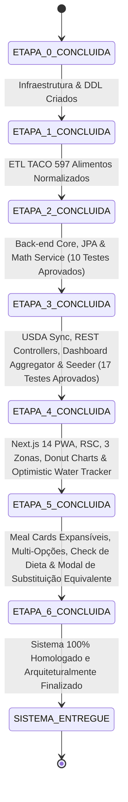

# 📋 99 - State Tracker, Inventário de Arquivos e Kanban

Este arquivo atua como o **Registrador de Estado e Auditor de Progresso** do projeto. 
Nenhuma etapa avança sem validação cruzada entre este arquivo, [[00_MOC_Mapa_Mental]], [[01_Data_Contracts_DDL_JSONB]] e [[02_API_&_Math_Specs]].

---

## 🚦 Status Geral do Projeto (State Machine)



---

## 📌 Quadro Kanban das Fases

| Etapa | Descrição | Status | Data de Conclusão | Evidência / Artefato Principal |
| :---: | :--- | :---: | :---: | :--- |
| **0** | **Inicialização do Cérebro Obsidian** | ✅ **CONCLUÍDO** | 16/11/2026 | 4 Notas estruturadas em `/docs/obsidian-vault/` |
| **1** | **Infraestrutura & Banco de Dados** | ✅ **CONCLUÍDO** | 16/11/2026 | `docker-compose.yml`, `V1__init_schema.sql` (Porta 5433) |
| **2** | **Engenharia de Dados (ETL TACO em Python)** | ✅ **CONCLUÍDO** | 16/11/2026 | `etl_taco.py`, `taco_raw.json` (597 alimentos no PostgreSQL) |
| **3** | **Back-end Core (Entidades, Math Service)** | ✅ **CONCLUÍDO** | 16/11/2026 | Spring Boot 3.3, Java 21, JPA, Math Engine (10/10 Testes OK) |
| **4** | **Back-end USDA, Controllers & Dashboard** | ✅ **CONCLUÍDO** | 16/11/2026 | RestClient USDA, 6 Controllers, CORS, Seeder, 17/17 Testes OK |
| **5** | **Front-end Next.js (Dashboard & Hidratação)** | ✅ **CONCLUÍDO** | 16/11/2026 | Next.js 14, PWA, RSC, 3 Zonas, 3 Donuts SVG, useOptimistic Water |
| **6** | **Front-end Next.js (Refeições & Substituição)** | ✅ **CONCLUÍDO** | 16/11/2026 | Cards expansíveis, Multi-Opção 1/2, Check Na Dieta, Modal Drift |
| **7** | **UX Avançada, Onboarding & Resiliência (Full-Stack)** | ✅ **CONCLUÍDO** | 17/11/2026 | TargetWizardModal, Quick Substitutions Top 5, Medidas Caseiras, TTL 6d, ADR-010 |
| **Patch** | **Patch Cumulativo: Transação, Auto-Onboarding, Proteína & Inputs** | ✅ **CONCLUÍDO** | 17/11/2026 | saveAndFlush uq_single_active, Slider Proteína 1.5-3.0, Leading Zeros fix, Logout/Reset |

---

## 📂 Inventário de Arquivos no Disco

### Governança e Configurações de Raiz
- `.gitignore` (Proteção estrita de segredos, caches de build Java/Python/Node e estado local do Obsidian)
- `.env.example` (Template de variáveis de ambiente com porta 5433 e credenciais da API USDA)
- `docker-compose.yml` (PostgreSQL 16 Alpine exposto na porta `5433:5432`)

### Front-end Next.js 14+ (`/frontend-nextjs/`)
- `frontend-nextjs/.env.local` (`NEXT_PUBLIC_API_BASE_URL` e `API_BASE_URL` configurados para `http://localhost:8080/api/v1`)
- `frontend-nextjs/src/app/manifest.ts` (Manifesto PWA com `display: standalone` e tema escuro `#090d16` / `#10b981`)
- `frontend-nextjs/src/app/layout.tsx` (Configuração de tema, viewport e fontes locais Geist)
- `frontend-nextjs/src/app/globals.css` (Tailwind base, custom scrollbar escura e color-scheme)
- `frontend-nextjs/src/app/page.tsx` (React Server Component mestre consumindo `/api/v1/dashboard`)
- `frontend-nextjs/src/app/actions.ts` (Server Action para atualização de hidratação com `revalidatePath('/')`)
- `frontend-nextjs/src/types/nutrition.ts` (Contratos TypeScript estritos para dados, metas, refeições e respostas da API)
- `frontend-nextjs/src/lib/api.ts` (Camada de acesso a dados RSC `no-store` e chamadas REST)
- `frontend-nextjs/src/components/CalorieHeader.tsx` (Cabeçalho com meta diária e Barra de 3 Zonas Progressivas com agulha)
- `frontend-nextjs/src/components/MacroDonutCharts.tsx` (3 Donut Charts SVG com gradiente para P/C/G e barra de fibras)
- `frontend-nextjs/src/components/WaterTracker.tsx` (Rastreador de água com `useOptimistic` e botões rápidos -250ml, +250ml, +500ml)
- `frontend-nextjs/src/components/MicronutrientMatrix.tsx` (Grade com os 9 micronutrientes e termômetro da razão Na:K)
- `frontend-nextjs/src/components/DateSelector.tsx` (Seletor e navegação rápida de datas)
- `frontend-nextjs/src/components/MealCards.tsx` (Cards expansíveis de refeições, alternador de Opção 1 e 2, check "Na Dieta" otimista)
- `frontend-nextjs/src/components/SubstitutionModal.tsx` (Modal de Substituição Equivalente, busca rápida TACO/USDA, cálculo de peso equivalente e Alerta de Calorie Drift)
- `frontend-nextjs/src/components/OffDietModal.tsx` (Modal de lançamento de refeição livre fora da dieta sem alteração de template)

### Documentação e Cofre Obsidian (`/docs/obsidian-vault/`)
- `docs/obsidian-vault/00_MOC_Mapa_Mental.md` (Mapa Mental, Arquitetura Mermaid, ADRs 001 a 007)
- `docs/obsidian-vault/01_Data_Contracts_DDL_JSONB.md` (Contratos DDL, Matriz de Tipos, JSONB, Flyway Baseline)
- `docs/obsidian-vault/02_API_&_Math_Specs.md` (Fórmulas LaTeX, Atwater, Substituição Híbrida, Endpoints REST)
- `docs/obsidian-vault/99_State_Tracker_Kanban.md` (Este arquivo: Tracker e Auditoria)

### Back-end Spring Boot (`/backend-spring/`)
- `backend-spring/pom.xml` (Maven, Java 21, Spring Boot 3.3.5, Hibernate 6, Flyway, PostgreSQL Driver)
- `backend-spring/src/main/resources/application.yml` (Virtual Threads Loom, Flyway Baseline, Porta 5433)
- `backend-spring/src/main/resources/db/migration/V1__init_schema.sql` (Migração Flyway idempotente)
- `backend-spring/src/main/java/com/precisionnutrition/PrecisionNutritionApplication.java`
- `backend-spring/src/main/java/com/precisionnutrition/config/`
  - `CorsConfig.java` (CORS global para Next.js na porta 3000 e IP da rede local)
  - `DatabaseSeeder.java` (Seed do protocolo "Cutting de Precisão" e 5 refeições com Opções 1 e 2)
- `backend-spring/src/main/java/com/precisionnutrition/controller/`
  - `DashboardController.java` (`GET /api/v1/dashboard`)
  - `FoodController.java` (`GET /api/v1/foods/search`, `GET /{id}`, `POST /custom`, `POST /usda-sync`)
  - `NutritionMathController.java` (`POST /api/v1/nutrition/substitute`, `POST /audit-atwater`)
  - `DailyTargetController.java` (`GET /api/v1/targets/active`, `GET /`, `POST /`, `PATCH /{id}/activate`)
  - `MealController.java` (`GET /api/v1/meals`, `POST /`, `PUT /{id}`, `DELETE /{id}`, `POST /items`)
  - `DailyLogController.java` (`GET /api/v1/logs/{date}`, `PATCH /water`, `POST /check-meal`, `POST /off-diet`, `DELETE /entries/{id}`)
- `backend-spring/src/main/java/com/precisionnutrition/exception/`
  - `GlobalExceptionHandler.java` (Tratamento centralizado com `ApiErrorResponse`)
  - `IncompatibleFoodSubstitutionException.java`
  - `FoodNotFoundException.java`
- `backend-spring/src/main/java/com/precisionnutrition/model/enums/` (`FoodSource`, `DominantMacro`, `MacroTarget`, `CalorieZone`)
- `backend-spring/src/main/java/com/precisionnutrition/model/dto/` (18 DTOs estritamente tipados com records imutáveis)
- `backend-spring/src/main/java/com/precisionnutrition/model/entity/` (`Food`, `DailyTarget`, `Meal`, `MealItem`, `DailyLog`, `DailyLogEntry` com anotações `@JsonManagedReference` / `@JsonBackReference`)
- `backend-spring/src/main/java/com/precisionnutrition/repository/` (`FoodRepository`, `DailyTargetRepository`, `MealRepository`, `MealItemRepository`, `DailyLogRepository`, `DailyLogEntryRepository`)
- `backend-spring/src/main/java/com/precisionnutrition/service/`
  - `NutritionMathService.java` e `NutritionMathServiceImpl.java`
  - `UsdaClientService.java` e `UsdaClientServiceImpl.java` (RestClient com cache permanente)
  - `FoodService.java` e `FoodServiceImpl.java`
  - `DailyTargetService.java` e `DailyTargetServiceImpl.java`
  - `MealService.java` e `MealServiceImpl.java`
  - `DailyLogService.java` e `DailyLogServiceImpl.java`
  - `DashboardService.java` e `DashboardServiceImpl.java`
- `backend-spring/src/test/java/com/precisionnutrition/controller/`
  - `DashboardControllerIntegrationTest.java` (4 testes de integração MockMvc)
  - `FoodControllerIntegrationTest.java` (3 testes de integração MockMvc)
- `backend-spring/src/test/java/com/precisionnutrition/service/NutritionMathServiceTest.java` (9 testes unitários)
- `backend-spring/src/test/java/com/precisionnutrition/repository/FoodRepositoryIntegrationTest.java` (1 teste de integração real com PostgreSQL 16)

---

## 📊 Resultados da Suíte de Testes Automatizados (Maven 3.9.9 + Java 21)

```text
[INFO] -------------------------------------------------------
[INFO]  T E S T S
[INFO] -------------------------------------------------------
[INFO] Running com.precisionnutrition.controller.DashboardControllerIntegrationTest
[INFO] Tests run: 4, Failures: 0, Errors: 0, Skipped: 0 -- in DashboardControllerIntegrationTest
[INFO] Running com.precisionnutrition.controller.FoodControllerIntegrationTest
[INFO] Tests run: 3, Failures: 0, Errors: 0, Skipped: 0 -- in FoodControllerIntegrationTest
[INFO] Running com.precisionnutrition.repository.FoodRepositoryIntegrationTest
[INFO] Tests run: 1, Failures: 0, Errors: 0, Skipped: 0 -- in FoodRepositoryIntegrationTest
[INFO] Running com.precisionnutrition.service.NutritionMathServiceTest
[INFO] Tests run: 9, Failures: 0, Errors: 0, Skipped: 0 -- in NutritionMathServiceTest
[INFO] 
[INFO] Results:
[INFO] 
[INFO] Tests run: 17, Failures: 0, Errors: 0, Skipped: 0
[INFO] 
[INFO] ------------------------------------------------------------------------
[INFO] BUILD SUCCESS
[INFO] ------------------------------------------------------------------------
[INFO] Total time:  14.534 s
```

### Casos de Teste Validados:
1. `DashboardControllerIntegrationTest.testGetDashboard`: Valida agregação em payload atômico (meta ativa, 5 refeições, matriz de micronutrientes, zona calórica e resumo).
2. `DashboardControllerIntegrationTest.testUpdateWater`: Valida atualização de hidratação e cálculo percentual dinâmico contra a meta diária (3500ml).
3. `DashboardControllerIntegrationTest.testCheckAndUncheckMealOption`: Valida comportamento de toggle idempotente (marcar opção 1 adiciona itens calculados ao log; marcar novamente desmarca e remove os lançamentos).
4. `DashboardControllerIntegrationTest.testAddOffDietEntry`: Valida registro de alimento livre/fora da dieta com snapshot e flag `is_off_diet = true`.
5. `FoodControllerIntegrationTest.testSearchFoods`: Valida consulta nativa `searchFuzzy` no PostgreSQL via trigramas e unaccent.
6. `FoodControllerIntegrationTest.testCreateCustomFood`: Valida persistência de alimento customizado com classificação automática de macro dominante.
7. `FoodControllerIntegrationTest.testSubstituteFood`: Valida endpoint de substituição equivalente e detecção de Calorie Drift Warning.
8. `FoodRepositoryIntegrationTest.testFuzzySearchWithUnaccentAndTrigram`: Consulta real no PostgreSQL 16 buscando `"pao frances"` sem acento e localizando `"Pão, francês"`.
9. `NutritionMathServiceTest` (9 testes unitários do motor matemático): Atwater, ratio Na:K, 4 zonas progressivas, substituição híbrida de Frango por Ovo com desvio $> 10\%$, incompatibilidade de macros e desempate para origem BALANCED.
