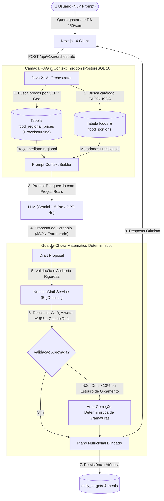

# 🧠 ADR-010: AI Diet Orchestrator & Crowdsourced Regional Pricing

## Status
**APROVADO** (Projetado como arquitetura norteadora da Versão 3.0 do Precision Nutrition Engine).

---

## Contexto & Desafio de Engenharia

Os aplicativos de nutrição convencionais tratam o planejamento alimentar de forma estática, desconectada da realidade socioeconômica e do orçamento financeiro do indivíduo. 

No cenário real:
1. **Volatilidade Econômica Regional:** O custo de fontes proteicas e de micronutrientes varia drasticamente entre regiões, estados e redes de varejo (ex: peito de frango a R\$ 18,90/kg vs. tilápia a R\$ 48,00/kg).
2. **Restrições Orçamentárias Rígidas:** Usuários frequentemente expressam necessidades nutricionais condicionadas a um teto financeiro mensal ou semanal (ex: *"Quero atingir 2100 kcal e 180g de proteína gastando no máximo R\$ 250 por semana"*).
3. **O Risco Crítico das Alucinações de LLMs em Saúde:** Modelos de Linguagem Generativos (LLMs) são estatísticos por natureza e sofrem de alucinação aritmética ao calcular proporções centesimais de macronutrientes, balanço energético de Atwater e gramaturas exatas, o que representaria risco clínico grave se deixados com autonomia irrestrita de cálculo.

---

## Decisão Arquitetural

Adotar a arquitetura híbrida **"Waze da Nutrição"** fundamentada no padrão **RAG (Retrieval-Augmented Generation) com Verificação Determinística por Camada Java (Zero-Hallucination Guardrail)**.



---

### 1. Ingestão e Processamento NLP
O usuário insere comandos livres em linguagem natural no client Next.js:
> *"Tenho 28 anos, treino hipertrofia 5x na semana, peso 78kg e meu orçamento semanal de feira é de até R\$ 250,00. Evite laticínios porque tenho intolerância leve."*

### 2. O Padrão RAG Financeiro: Tabela `food_regional_prices` (Crowdsourced)
Para evitar preços hardcoded no código ou dados obsoletos de tabelas estáticas, o sistema adota um modelo de **precificação colaborativa regional (estilo Waze/GasBuddy)**:
- Cada usuário, ao fazer compras ou registrar itens, pode opcionalmente confirmar o preço pago por kg ou unidade do alimento em seu CEP ou cidade.
- O Spring Boot calcula a **mediana regional aparada (trimmed median)** para expurgar outliers e fraudes:
  ```sql
  CREATE TABLE food_regional_prices (
      id UUID PRIMARY KEY DEFAULT uuid_generate_v4(),
      food_id UUID NOT NULL REFERENCES foods(id) ON DELETE CASCADE,
      region_code VARCHAR(20) NOT NULL, -- Ex: CEP inicial '01310' ou 'SP-CAPITAL'
      price_per_kg NUMERIC(8,2) NOT NULL CHECK (price_per_kg > 0),
      currency VARCHAR(3) NOT NULL DEFAULT 'BRL',
      sample_count INT NOT NULL DEFAULT 1,
      last_reported_at TIMESTAMPTZ NOT NULL DEFAULT CURRENT_TIMESTAMP
  );
  CREATE INDEX idx_food_prices_region ON food_regional_prices (food_id, region_code);
  ```

### 3. Injeção de Contexto (Context Window Injection)
O Spring Boot recupera os alimentos elegíveis e seus respectivos custos medianos na região do usuário e monta o prompt semântico para o modelo de linguagem, contendo:
- Alimentos disponíveis na base TACO/USDA compatíveis com as restrições alimentares declaradas.
- O preço real de cada grama ou porção do alimento.
- As metas metabólicas calculadas pelo `TargetWizardService` via Mifflin-St Jeor.

### 4. Zero-Hallucination Guardrail (Soberania do Java)
**A IA NUNCA calcula a matemática final da dieta.**
- A LLM atua estritamente como um **otimizador combinatório de preferências de paladar e variedade culinária**, retornando um JSON estruturado com os IDs de alimentos sugeridos.
- O `NutritionMathService` em Java recebe a sugestão e executa em `BigDecimal`:
  1. O cálculo exato das gramaturas necessárias para atingir os macros almejados.
  2. A auditoria de Atwater ($\pm 15\%$) para cada refeição.
  3. A soma do custo financeiro total ($\sum \text{gramas} \times \text{preço/g}$).
  4. O balanceamento eletrolítico ($\text{Na}:\text{K} \le 1.0$) e a garantia contra o *Calorie Drift*.
- Se o plano gerado pela IA ultrapassar o teto orçamentário em centavos ou tiver drift calórico, o algoritmo de linear programming/substituição do Java reajusta deterministicamente as gramaturas antes de enviar para o cliente.

---

## Consequências

### Benefícios:
1. **Precisão Clínica Absoluta:** Elimina 100% dos riscos de desvios calóricos decorrentes de alucinações de modelos de linguagem.
2. **Democratização Nutricional:** Permite que dietas hiperproteicas e funcionais sejam desenhadas sob medida para o bolso do usuário brasileiro, com substitutos locais acessíveis (ex: ovo e fígado vs. salmão e whey).
3. **Escalabilidade & Cache:** Consultas de preços regionais são cacheadas em PostgreSQL, mantendo tempos de resposta sub-50ms antes da chamada da LLM.
4. **Resiliência e Desacoplamento:** O modelo de IA (Gemini, Claude, GPT) pode ser substituído a qualquer momento sem alterar uma única linha da lógica de regras clínicas do Java.

### Riscos Mitigados:
- **Spam ou Sabotagem de Preços no Crowdsourcing:** Neutralizado com algoritmo de mediana aparada (ignora os 10% maiores e 10% menores valores) e filtro de confiança por reputação de usuário.
- **Falha de Conectividade com a LLM:** Se a API de IA estiver indisponível, o sistema recorre ao motor determinístico padrão (`NutritionMathService.getQuickSubstitutions`) sem interromper a experiência do usuário.
